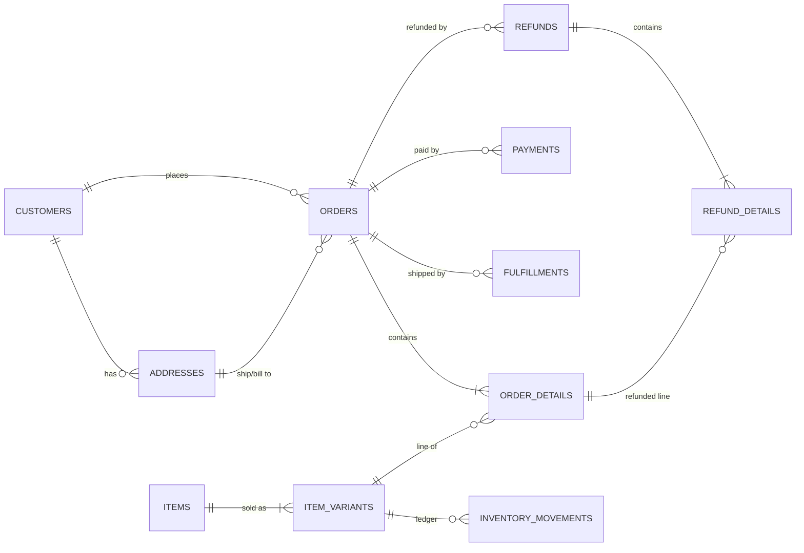
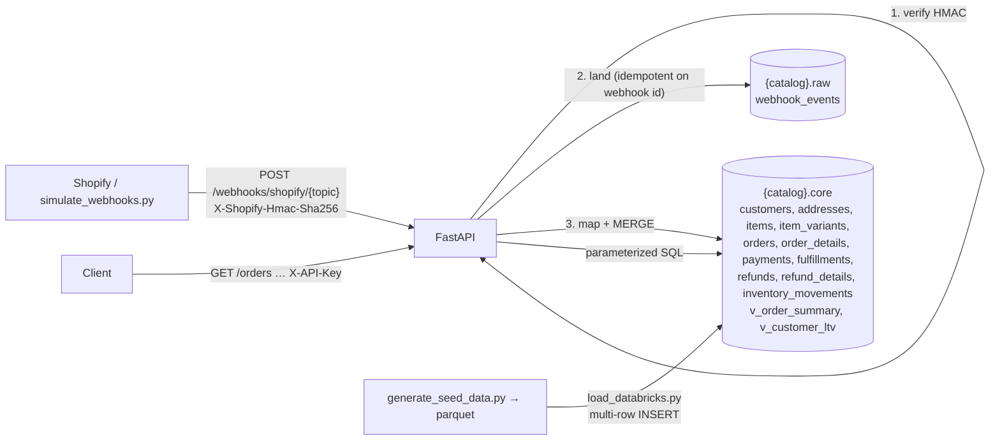

# Commerce FastAPI + Databricks POC

## 1. What this is

A runnable proof of concept for a personal-care / household shop (Hair Care, Skin Care, Bath & Body, Fragrance, Home Care):

- **Databricks Unity Catalog is the system of record.** It has two schemas: `raw` (an immutable webhook landing log) and `core` (current-state commerce tables).
- **FastAPI is a thin layer** on top. It has
  - typed, paginated, API-key-protected query endpoints over `core.*`, and
  - an HMAC-verified Shopify-style webhook endpoint. Each webhook is landed in `raw.webhook_events`, then MERGEd into `core.*`.
- **Synthetic history at demo scale:** 500 customers, 200 items (364 variants) and 5,000 orders over the last 18 months, plus about 10.6k order lines, payments, fulfillments, refunds and an inventory ledger. Generation is deterministic and dates are anchored to today.

No dbt, no MetricFlow, no Terraform, no second warehouse.

## 2. Data model





- Internal ids are deterministic hashes of the provider id, for example `ord_<sha1(shopify|gid://shopify/Order/…)>`. A webhook about a seeded order therefore lands on the same row. Provider ids (`gid://shopify/...`) are stored alongside them.
- PKs are informational Unity Catalog `PRIMARY KEY` constraints. FKs are documented in column comments and enforced by the generator and the MERGE code (unseen products get insert-only stub items and variants).
- On orders, `total = subtotal - discount + tax + shipping` and `subtotal/discount/tax = Σ lines`. This holds for seed data and for webhook-mapped orders, and the loader's sanity checks verify it.

The full DDL is in [`sql/ddl.sql`](sql/ddl.sql). Named queries are in [`sql/queries/`](sql/queries).

## 3. Databricks setup (private account)

1. **SQL warehouse:** go to *SQL Warehouses → (yours) → Connection details*. Copy the **Server hostname** into `DATABRICKS_HOST` and the **HTTP path** into `DATABRICKS_HTTP_PATH`. Serverless Starter is fine.
2. **Personal access token:** go to *User settings → Developer → Access tokens → Generate*. Put it in `DATABRICKS_TOKEN`.
3. **Catalog:** the bootstrap runs `CREATE CATALOG IF NOT EXISTS`. If you aren't allowed to create catalogs, point `DATABRICKS_CATALOG` at one where you have `USE CATALOG` + `CREATE SCHEMA`.
4. Then:

```bash
cp .env.example .env      # fill in host / http path / token / catalog
python3.12 -m venv .venv && source .venv/bin/activate
pip install -r requirements.txt
```

**Safety in shared catalogs:** the bootstrap tags the schemas it creates with `commerce_poc.managed=true`. It refuses to touch an existing, non-empty `core`/`raw` schema that lacks that tag. In that case, pick other names with `DATABRICKS_SCHEMA_CORE` / `DATABRICKS_SCHEMA_RAW`, or pass `--force`.

## 4. Run it

The one-shot path takes about 2.5–3 minutes on a serverless warehouse. It runs DDL, generates data, bulk-loads it, sends 6 sample webhooks through the real ingest path, and runs sanity checks:

```bash
python -m scripts.bootstrap_databricks
uvicorn app.main:app --reload
```

Or step by step:

```bash
python -m scripts.bootstrap_databricks --ddl-only   # catalog, schemas, tables, views
python -m scripts.generate_seed_data                # -> data/generated/*.parquet (+ data/sample/*.csv)
python -m scripts.load_databricks                   # TRUNCATE + chunked INSERT, row counts, sanity checks
uvicorn app.main:app --reload                       # http://127.0.0.1:8000/docs
python -m scripts.simulate_webhooks                 # signed orders/create → updated → refunds/create → replay
```

`--recreate` on the bootstrap drops and recreates the POC tables (only in POC-owned schemas).

Tests:

```bash
pytest                                              # unit tests, Databricks mocked
RUN_DATABRICKS_INTEGRATION=1 pytest -m integration  # against the real warehouse
```

## 5. curl examples

```bash
K='X-API-Key: dev-api-key'
curl -s localhost:8000/health
curl -s -H "$K" localhost:8000/health/databricks
curl -s -H "$K" 'localhost:8000/customers?region=West&segment=SMB&limit=5'
curl -s -H "$K" 'localhost:8000/customers?q=patel'
curl -s -H "$K" 'localhost:8000/items?category=Hair%20Care&q=lavender'
curl -s -H "$K" 'localhost:8000/orders?status=refunded&date_from=2026-01-01&date_to=2026-03-31&limit=20&offset=0'
curl -s -H "$K" 'localhost:8000/orders/ord_…'          # header + lines + payments + fulfillments + refunds
curl -s -H "$K" 'localhost:8000/refunds?date_from=2026-09-01'
curl -s -H "$K" 'localhost:8000/webhooks/events?status=failed'
curl -s -H "$K" localhost:8000/stats/overview
```

List responses look like `{"items": [...], "total": 5000, "limit": 50, "offset": 0}`. `limit` defaults to 50 with a max of 200. Money is a two-decimal string (`"64.52"`). Timestamps are ISO-8601 UTC (`"2026-10-21T14:15:00Z"`).

Signed webhook:

```bash
BODY=$(cat tests/fixtures/shopify/orders_create.json)
SIG=$(printf '%s' "$BODY" | openssl dgst -sha256 -hmac 'dev-webhook-secret' -binary | base64)
curl -s localhost:8000/webhooks/shopify/orders_create \
  -H 'Content-Type: application/json' \
  -H "X-Shopify-Hmac-Sha256: $SIG" \
  -H 'X-Shopify-Topic: orders/create' \
  -H "X-Shopify-Webhook-Id: demo-$(date +%s)" \
  --data-binary "$BODY"
# {"status":"applied","event_id":"demo-…","topic":"orders/create","applied":{"customers":1,"addresses":2,...}}
# same webhook id again -> {"status":"duplicate",...}; wrong secret -> 401
```

| Response | Meaning |
|---|---|
| 200 `applied` | Landed in `raw` and MERGEd into `core` |
| 200 `accepted` | `WEBHOOK_APPLY_MODE=background` only: stored in `raw`, and the apply runs after the response |
| 200 `duplicate` | Webhook id already applied, so nothing was done |
| 202 `skipped` | Topic has no mapper. Stored in `raw` only |
| 401 | Bad or missing HMAC. Nothing is written to `core`; the attempt is logged in `raw` under a generated `rejected_…` id |
| 500 `failed` | Stored, but the apply failed (for example, a refund arrived before its order). Shopify retries, and a retry reprocesses the event |

**Topics mapped:** `orders/create|updated|paid|fulfilled|cancelled`, `refunds/create`, `products/create|update` and `customers/create|update`. Each function in [`app/services/shopify_mapper.py`](app/services/shopify_mapper.py) documents the exact payload fields it honors. The `X-Shopify-Topic` header takes precedence over the path segment.

## 6. Pointing a real Shopify store at it

```bash
uvicorn app.main:app --port 8000
ngrok http 8000            # -> https://<id>.ngrok-free.app
```

Set `WEBHOOK_APPLY_MODE=background` first (see the shortcuts below). Then, in Shopify admin, go to *Settings → Notifications → Webhooks* (or use a custom app's webhook subscriptions). Add `https://<id>.ngrok-free.app/webhooks/shopify/orders_create` and so on for each topic, in JSON format. Set `SHOPIFY_WEBHOOK_SECRET` to the signing secret Shopify shows (the app's API secret for app-created webhooks).

## 7. Known POC shortcuts

- **Synchronous apply (default):** the webhook request lands the raw event *and* applies the MERGEs. On a serverless SQL warehouse each Delta commit takes about 1–3 s and reads about 0.3 s. The core MERGEs for one event already run in parallel, but there are still three commits in a row (land, MERGE, mark). Measured end to end, that's **about 6–10 s per webhook**, which is over Shopify's 5 s limit.
  - A Shopify timeout is harmless: the retry carries the same webhook id and returns `duplicate`.
  - For a real store, set **`WEBHOOK_APPLY_MODE=background`**. The request then returns 200 `accepted` after landing (measured at 1.4–3 s), and the apply runs right after the response in the same process.
  - Production would replace that with a queue or job, so an apply isn't lost if the process dies. A landed event left in `received` can simply be re-applied.
- **Idempotency:** this is check-then-insert on `event_id`. Two concurrent deliveries of the same id could both apply. The MERGEs are idempotent, so the result is the same, but it's not strictly once.
- **Auth:** a PAT for Databricks and a static `X-API-Key` for the API. Production would use OAuth M2M / a service principal and real API auth.
- **History:** no SCD2. `core` is current state, and `raw.webhook_events` is the history. Updates COALESCE, so a field missing from a payload never wipes a stored value, but a field also can't be cleared to NULL via webhook. An `updated_at` guard ignores out-of-order older updates.
- **Line removals:** order lines missing from an `orders/updated` payload are not deleted.
- **Inventory:** webhook orders don't write inventory movements. Only seed data has a full ledger.
- **Money:** `DECIMAL(18,2)`. Orders are in USD/CAD/GBP, but GMV in `/stats/overview` sums them as-is, and variant prices are in a single nominal currency.
- **Bulk load:** the seed load renders trusted, generated values as SQL literals in 1,000-row INSERTs. That's the fastest path without a Volume. Every API and webhook path uses bound parameters.
- **Backend:** there is no local/SQLite backend. If Databricks is unreachable, data endpoints return 503 with the connector error, and `/health` stays up.

## Layout

```
app/        main.py config.py db.py deps.py models.py tables.py logging_setup.py
            routers/{health,customers,items,orders,refunds,webhooks,stats}.py
            services/{shopify_mapper,ingest}.py
sql/        ddl.sql, queries/*.sql (named, parameterized)
scripts/    bootstrap_databricks.py generate_seed_data.py load_databricks.py simulate_webhooks.py
tests/      TestClient + in-memory fakes, fixtures/shopify/*.json, optional integration test
```
