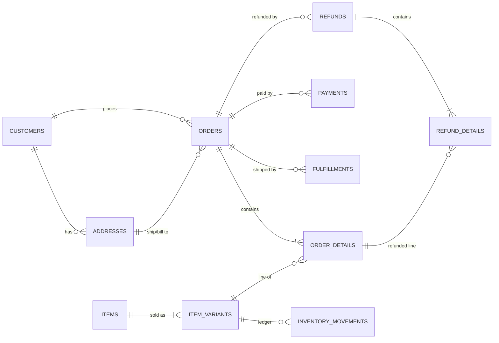
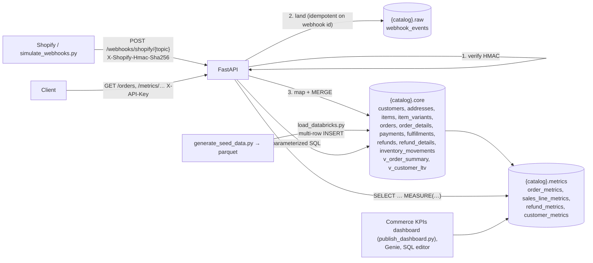

# Commerce FastAPI + Databricks POC

## 1. What this is

A runnable proof of concept for a personal-care / household shop (Hair Care, Skin Care, Bath & Body, Fragrance, Home Care):

- **Databricks Unity Catalog is the system of record.** It has three schemas: `raw` (an immutable webhook landing log), `core` (current-state commerce tables) and `metrics` (Unity Catalog **metric views**: governed KPI definitions over `core`).
- **FastAPI is a thin layer** on top. It has
  - typed, paginated, API-key-protected query endpoints over `core.*`,
  - a `/metrics` endpoint that queries the metric views with `MEASURE()`, and
  - an HMAC-verified Shopify-style webhook endpoint. Each webhook is landed in `raw.webhook_events`, then MERGEd into `core.*`.
- **Synthetic history at demo scale:** 500 customers, 200 items (364 variants) and 5,000 orders over the last 18 months, plus about 10.6k order lines, payments, fulfillments, refunds and an inventory ledger. Generation is deterministic and dates are anchored to today.

No dbt, no MetricFlow, no Terraform, no second warehouse. KPIs are defined once, as Databricks metric views (see [section 5](#5-metric-views)).

## 2. Data model





- Internal ids are deterministic hashes of the provider id, for example `ord_<sha1(shopify|gid://shopify/Order/…)>`. A webhook about a seeded order therefore lands on the same row. Provider ids (`gid://shopify/...`) are stored alongside them.
- PKs are informational Unity Catalog `PRIMARY KEY` constraints. FKs are documented in column comments and enforced by the generator and the MERGE code (unseen products get insert-only stub items and variants).
- On orders, `total = subtotal - discount + tax + shipping` and `subtotal/discount/tax = Σ lines`. This holds for seed data and for webhook-mapped orders, and the loader's sanity checks verify it.

The full DDL is in [`sql/ddl.sql`](sql/ddl.sql). Named queries are in [`sql/queries/`](sql/queries).

## 3. Databricks setup (private account)

1. **SQL warehouse:** go to *SQL Warehouses → (yours) → Connection details*. Copy the **Server hostname** into `DATABRICKS_HOST` and the **HTTP path** into `DATABRICKS_HTTP_PATH`. Serverless Starter is fine.
2. **Personal access token:** go to *User settings → Developer → Access tokens → Generate*. Put it in `DATABRICKS_TOKEN`.
3. **Catalog:** the bootstrap runs `CREATE CATALOG IF NOT EXISTS`. If you aren't allowed to create catalogs, point `DATABRICKS_CATALOG` at one where you have `USE CATALOG` + `CREATE SCHEMA`.
4. Then:

```bash
cp .env.example .env      # fill in host / http path / token / catalog
python3.12 -m venv .venv && source .venv/bin/activate
pip install -r requirements.txt
```

**Safety in shared catalogs:** the bootstrap tags the schemas it creates with `commerce_poc.managed=true`. It refuses to touch an existing, non-empty `core`/`raw`/`metrics` schema that lacks that tag. In that case, pick other names with `DATABRICKS_SCHEMA_CORE` / `DATABRICKS_SCHEMA_RAW` / `DATABRICKS_SCHEMA_METRICS`, or pass `--force`.

**Metric views** need a SQL warehouse recent enough to support `CREATE VIEW … WITH METRICS` (YAML spec version 1.1). Serverless is fine; this repo was verified on DBSQL 2026.42.

## 4. Run it

The one-shot path takes about 2.5–3 minutes on a serverless warehouse. It runs DDL, creates the metric views, generates data, bulk-loads it, sends 6 sample webhooks through the real ingest path, and runs sanity checks:

```bash
python -m scripts.bootstrap_databricks
uvicorn app.main:app --reload
```

Or step by step:

```bash
python -m scripts.bootstrap_databricks --ddl-only   # catalog, schemas, tables, views, metric views
python -m scripts.generate_seed_data                # -> data/generated/*.parquet (+ data/sample/*.csv)
python -m scripts.load_databricks                   # TRUNCATE + chunked INSERT, row counts, sanity checks
uvicorn app.main:app --reload                       # http://127.0.0.1:8000/docs
python -m scripts.simulate_webhooks                 # signed orders/create → updated → refunds/create → replay
```

`--recreate` on the bootstrap drops and recreates the POC tables (only in POC-owned schemas). After editing a file in `sql/metric_views/`, run `python -m scripts.bootstrap_databricks --metrics-only` to re-create just the metric views (a few seconds, no data touched).

Tests:

```bash
pytest                                              # unit tests, Databricks mocked
RUN_DATABRICKS_INTEGRATION=1 pytest -m integration  # against the real warehouse
```

## 5. Metric views

Each file in [`sql/metric_views/`](sql/metric_views) is one Unity Catalog metric view, created as `{catalog}.metrics.<file name>`. A metric view has one source (which fixes its grain) plus many-to-one joins, so there is one view per grain:

| Metric view | Grain / source | Time dimension | Example measures |
|---|---|---|---|
| `order_metrics` | order (`core.v_order_summary`) + customer, fx | `order_date` | `valid_orders`, `gmv_usd`, `aov_usd`, `net_revenue_usd`, `refund_rate`, `cancel_rate` |
| `sales_line_metrics` | order line (`core.order_details`) + order → customer/fx, item, variant | `order_date` | `units_sold`, `line_revenue_usd`, `avg_unit_price_usd`, `discount_rate` |
| `refund_metrics` | refund (`core.refunds`) + order → customer, fx | `refund_date` | `refunds`, `refunded_usd`, `avg_refund_usd` |
| `customer_metrics` | customer (`core.v_customer_ltv`) | `first_order_date` (cohort) | `buyers`, `repeat_rate`, `avg_ltv_usd` |

`GET /metrics` lists every dimension and measure with its description.

**Conventions**

- Revenue measures exclude cancelled orders. Refunds count only `succeeded` refunds.
- **Currency.** `*_usd` measures convert each row through `core.fx_rates`. Measures without the suffix (`gmv`, `refunded_amount`, `line_revenue`) are in each order's own currency. Only use them grouped or filtered by `currency`.
- **Refund timing.** `order_metrics.refunded_usd` attributes refunds to the *order* date ("how much of September's sales came back"). `refund_metrics.refunded_usd` uses the *refund* date ("how much did we refund in September").
- **Freshness.** These are views, so webhook MERGEs show up immediately. There is nothing to refresh.
- **One definition.** `/stats/overview` reads GMV and refunds from `order_metrics`. The integration tests check that the four views reconcile with each other: line revenue = GMV − shipping, refund totals match, and customer LTV ≈ net revenue.

**Querying in SQL** (SQL editor, AI/BI dashboards, Genie):

```sql
SELECT order_month, region, MEASURE(gmv_usd), MEASURE(aov_usd), MEASURE(refund_rate)
FROM distribution_sandbox.metrics.order_metrics
WHERE order_date >= '2026-01-01'
GROUP BY ALL
ORDER BY order_month
```

**Querying over HTTP:** `GET /metrics/{view}` runs the same query.

| Parameter | Meaning |
|---|---|
| `measures` (required) | Comma-separated or repeated measure names |
| `dimensions` | Group by these. Omit for a single total row |
| `date_from`, `date_to` | Inclusive, on the view's time dimension |
| `filter=dimension:value` | Repeatable. Same dimension = OR, different dimensions = AND |
| `order_by`, `desc` | One of the requested dimensions or measures. Default order is by dimensions |
| `limit` | Default 100, max 1000. `truncated: true` means more rows matched |

Measure values are JSON numbers, not the two-decimal strings that entity endpoints use, so they can go straight into a chart. Names are checked against the YAML before they reach SQL, because identifiers can't be bound as parameters. Values are always bound.

**Adding or changing a metric**

1. Edit or add a YAML file in `sql/metric_views/`. Use the Databricks metric-view spec (`version: "1.1"`, `source`, `joins`, `dimensions`, `measures`). Write `{core}` for the core schema; it's replaced with the configured `` `catalog`.`schema` ``. Add the one repo-specific block, `api: {time_dimension: <a DATE dimension>}`, which is stripped before the YAML goes to Databricks.
2. Reference nested joins by path (`ord.customer.region`). Compose measures with `MEASURE(other_measure)`.
3. Run `pytest tests/test_metrics.py`, then `python -m scripts.bootstrap_databricks --metrics-only`, then `RUN_DATABRICKS_INTEGRATION=1 pytest -m integration`. The integration test evaluates every measure and dimension of every view.

### Dashboard

`python -m scripts.publish_dashboard` builds an AI/BI (Lakeview) dashboard, **Commerce KPIs (metric views)**, in your workspace home folder and publishes it. Re-running it updates the same dashboard in place. It prints the dashboard URL.

| Page | Contents |
|---|---|
| **Sales** | GMV, net revenue, orders, AOV, buyers and refund rate. Monthly GMV, net revenue, orders, AOV and refund rate. Revenue by category, GMV by segment and channel. Top 15 products |
| **Refunds & customers** | Refunded USD by refund month and by reason. New buyers and average LTV by first-order cohort. A cohort table with repeat rate |

How it's built:

- The dashboard is defined in Python in [`scripts/publish_dashboard.py`](scripts/publish_dashboard.py), next to the metric views it reads, so it's reviewed and versioned like code.
- Every dataset is a SQL query that calls `MEASURE()` on `{catalog}.metrics.*`.
- The **date from / to** and **region** filters are dashboard *parameters* used in each dataset's `WHERE` clause. The metric view therefore computes ratios like AOV and refund rate for the filtered slice; the chart never averages pre-computed ratios.
- Default dates are 2025-01-01 to 2026-12-31, set by `DEFAULT_FROM` / `DEFAULT_TO` in the script.

Options:

- `--check` only runs every dataset query with the default parameters. The script always does this before publishing.
- `--out file.lvdash.json` also writes the JSON, which you can import from the Dashboards UI.
- `--no-publish` updates the draft only.
- `--parent-path` publishes to a different workspace folder.
- `--embed-credentials` makes viewers query with your credentials instead of their own.

`tests/test_dashboard.py` checks offline that every widget references a real dataset, field and parameter, that every filtered dataset is wired to its page's filters, and that the layout has no overlapping widgets.

## 6. curl examples

```bash
K='X-API-Key: dev-api-key'   # or whatever API_KEY is set to in .env
curl -s localhost:8000/health
curl -s -H "$K" localhost:8000/health/databricks
curl -s -H "$K" 'localhost:8000/customers?region=West&segment=SMB&limit=5'
curl -s -H "$K" 'localhost:8000/customers?q=patel'
curl -s -H "$K" 'localhost:8000/items?category=Hair%20Care&q=lavender'
curl -s -H "$K" 'localhost:8000/orders?status=refunded&date_from=2026-01-01&date_to=2026-03-31&limit=20&offset=0'
curl -s -H "$K" 'localhost:8000/orders/ord_…'          # header + lines + payments + fulfillments + refunds
curl -s -H "$K" 'localhost:8000/refunds?date_from=2026-09-01'
curl -s -H "$K" 'localhost:8000/webhooks/events?status=failed'
curl -s -H "$K" localhost:8000/stats/overview
curl -s -H "$K" localhost:8000/metrics
curl -s -H "$K" 'localhost:8000/metrics/order_metrics?measures=valid_orders,gmv_usd,aov_usd,refund_rate&dimensions=order_month&date_from=2026-07-01'
curl -s -H "$K" 'localhost:8000/metrics/sales_line_metrics?measures=units_sold,line_revenue_usd&dimensions=category&order_by=line_revenue_usd&desc=true'
curl -s -H "$K" 'localhost:8000/metrics/refund_metrics?measures=refunds,refunded_usd&dimensions=reason&filter=region:West&filter=region:East'
curl -s -H "$K" 'localhost:8000/metrics/customer_metrics?measures=buyers,repeat_rate,avg_ltv_usd&dimensions=segment'
```

A metric response looks like this:

```json
{"view":"order_metrics","dimensions":["order_month"],"measures":["valid_orders","gmv_usd","aov_usd","refund_rate"],
 "rows":[{"order_month":"2026-09-01","valid_orders":598,"gmv_usd":44102.1576,"aov_usd":73.74942742,"refund_rate":0.09698996655518395}],
 "row_count":1,"truncated":false}
```

List responses look like `{"items": [...], "total": 5000, "limit": 50, "offset": 0}`. `limit` defaults to 50 with a max of 200. Money is a two-decimal string (`"64.52"`). Timestamps are ISO-8601 UTC (`"2026-10-21T14:15:00Z"`).

Signed webhook:

```bash
BODY=$(cat tests/fixtures/shopify/orders_create.json)
SIG=$(printf '%s' "$BODY" | openssl dgst -sha256 -hmac 'dev-webhook-secret' -binary | base64)
curl -s localhost:8000/webhooks/shopify/orders_create \
  -H 'Content-Type: application/json' \
  -H "X-Shopify-Hmac-Sha256: $SIG" \
  -H 'X-Shopify-Topic: orders/create' \
  -H "X-Shopify-Webhook-Id: demo-$(date +%s)" \
  --data-binary "$BODY"
# {"status":"applied","event_id":"demo-…","topic":"orders/create","applied":{"customers":1,"addresses":2,...}}
# same webhook id again -> {"status":"duplicate",...}; wrong secret -> 401
```

| Response | Meaning |
|---|---|
| 200 `applied` | Landed in `raw` and MERGEd into `core` |
| 200 `accepted` | `WEBHOOK_APPLY_MODE=background` only: stored in `raw`, and the apply runs after the response |
| 200 `duplicate` | Webhook id already applied, so nothing was done |
| 202 `skipped` | Topic has no mapper. Stored in `raw` only |
| 401 | Bad or missing HMAC. Nothing is written to `core`; the attempt is logged in `raw` under a generated `rejected_…` id |
| 500 `failed` | Stored, but the apply failed (for example, a refund arrived before its order). Shopify retries, and a retry reprocesses the event |

**Topics mapped:** `orders/create|updated|paid|fulfilled|cancelled`, `refunds/create`, `products/create|update` and `customers/create|update`. Each function in [`app/services/shopify_mapper.py`](app/services/shopify_mapper.py) documents the exact payload fields it honors. The `X-Shopify-Topic` header takes precedence over the path segment.

## 7. Pointing a real Shopify store at it

```bash
uvicorn app.main:app --port 8000
ngrok http 8000            # -> https://<id>.ngrok-free.app
```

Set `WEBHOOK_APPLY_MODE=background` first (see the shortcuts below). Then, in Shopify admin, go to *Settings → Notifications → Webhooks* (or use a custom app's webhook subscriptions). Add `https://<id>.ngrok-free.app/webhooks/shopify/orders_create` and so on for each topic, in JSON format. Set `SHOPIFY_WEBHOOK_SECRET` to the signing secret Shopify shows (the app's API secret for app-created webhooks).

## 8. Known POC shortcuts

- **Synchronous apply (default):** the webhook request lands the raw event *and* applies the MERGEs. On a serverless SQL warehouse each Delta commit takes about 1–3 s and reads about 0.3 s. The core MERGEs for one event already run in parallel, but there are still three commits in a row (land, MERGE, mark). Measured end to end, that's **about 6–10 s per webhook**, which is over Shopify's 5 s limit.
  - A Shopify timeout is harmless: the retry carries the same webhook id and returns `duplicate`.
  - For a real store, set **`WEBHOOK_APPLY_MODE=background`**. The request then returns 200 `accepted` after landing (measured at 1.4–3 s), and the apply runs right after the response in the same process.
  - Production would replace that with a queue or job, so an apply isn't lost if the process dies. A landed event left in `received` can simply be re-applied.
- **Idempotency:** this is check-then-insert on `event_id`. Two concurrent deliveries of the same id could both apply. The MERGEs are idempotent, so the result is the same, but it's not strictly once.
- **Auth:** a PAT for Databricks and a static `X-API-Key` for the API. Production would use OAuth M2M / a service principal and real API auth.
- **History:** no SCD2. `core` is current state, and `raw.webhook_events` is the history. Updates COALESCE, so a field missing from a payload never wipes a stored value, but a field also can't be cleared to NULL via webhook. An `updated_at` guard ignores out-of-order older updates.
- **Line removals:** order lines missing from an `orders/updated` payload are not deleted.
- **Inventory:** webhook orders don't write inventory movements. Only seed data has a full ledger.
- **Money:** `DECIMAL(18,2)`. Orders are in USD/CAD/GBP. `gmv` / `refunded_amount` in `/stats/overview` sum them as-is (kept for continuity); `gmv_usd` / `net_revenue_usd` convert them. Variant prices and costs are in a single nominal currency, which is why there is no margin metric yet.
- **FX:** `core.fx_rates` holds one static, illustrative rate per currency, seeded by `sql/ddl.sql`. Production would load dated rates and join on order date. An order in a currency missing from the table drops out of `*_usd` measures, and the loader's sanity checks report it.
- **Metric views:** the `api:` block in each YAML file is a repo convention, not part of the Databricks spec. The YAML is parsed with YAML 1.2 booleans, because under YAML 1.1 a join's `on:` key would become `true`. The metric views aren't materialized; at this data size every query takes about 1 s.
- **Seed data and repeat rate:** the generator spreads 5,000 orders over 500 customers, so nearly every buyer is a repeat buyer (`repeat_rate` ≈ 1). The metric is correct; the synthetic data is just not realistic on that axis.
- **Bulk load:** the seed load renders trusted, generated values as SQL literals in 1,000-row INSERTs. That's the fastest path without a Volume. Every API and webhook path uses bound parameters.
- **Backend:** there is no local/SQLite backend. If Databricks is unreachable, data endpoints return 503 with the connector error, and `/health` stays up.

## Layout

```
app/        main.py config.py db.py deps.py models.py tables.py metrics.py logging_setup.py
            routers/{health,customers,items,orders,refunds,webhooks,stats,metrics}.py
            services/{shopify_mapper,ingest}.py
sql/        ddl.sql, queries/*.sql (named, parameterized), metric_views/*.yaml (UC metric views)
scripts/    bootstrap_databricks.py generate_seed_data.py load_databricks.py simulate_webhooks.py publish_dashboard.py
tests/      TestClient + in-memory fakes, fixtures/shopify/*.json, optional integration test
```
